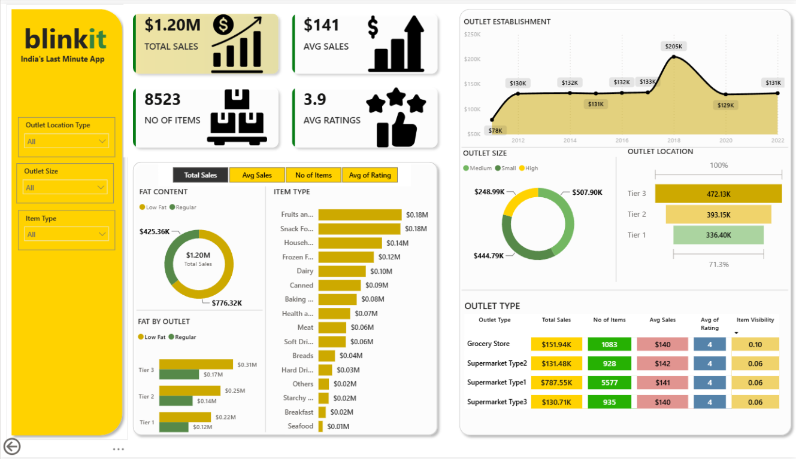

# Blinkit Sales Dashboard

An interactive Blinkit sales analysis dashboard built with Microsoft Power BI. The report presents sales KPIs, outlet performance, product-category analysis, and interactive filters.

## Dashboard Preview



## Project Objectives

- Present headline sales and rating metrics in a single report.
- Explore performance across outlet and product dimensions.
- Provide interactive filtering for common outlet and item attributes.

## Tools and Technologies

- Microsoft Power BI Desktop
- Power BI report (`.pbix`)
- Markdown documentation

The repository does not document specific DAX measures, Power Query transformations, or a Power BI version.

## Dataset

The dataset source and download location are not documented in the repository. No external dataset link or provenance is asserted here.

## Dashboard KPIs

| KPI | Displayed value |
| --- | ---: |
| Total Sales | $1.20M |
| Average Sales | $141 |
| Number of Items | 8,523 |
| Average Rating | 3.9 |

## Dashboard Features and Analysis

The dashboard includes analysis views for:

- Outlet Establishment
- Fat Content
- Item Type
- Outlet Size
- Outlet Location
- Outlet Type

## Available Filters

- Outlet Location Type
- Outlet Size
- Item Type

## Visible Observations

These are observations from the supplied dashboard preview, not conclusions about the underlying dataset:

- The report displays total sales of $1.20M, average sales of $141, 8,523 items, and an average rating of 3.9.
- The Outlet Establishment visual shows values by year, including a visible high point of $205K in 2018.
- The Outlet Type table compares total sales, number of items, average sales, average rating, and item visibility across outlet types.

## How to Use the Project

1. Clone or download this repository.
2. Open `Blinkit_Sales_Dashboard.pbix` using Microsoft Power BI Desktop.
3. Interact with the report filters and visuals.

## Limitations and Assumptions

- The PBIX file is required to inspect and interact with the report.
- The repository does not include a documented dataset source or separate data extract.
- The screenshot is a static preview and does not provide report interactivity.
- Calculations and transformations inside the PBIX are not described because they were not independently documented in the repository.

## Repository Structure

```text
.
├── Blinkit_Sales_Dashboard.pbix
├── README.md
├── .gitignore
└── screenshots/
    ├── .gitkeep
    └── blinkit-dashboard.png
```

## Author

[pawan-aicode](https://github.com/pawan-aicode)
